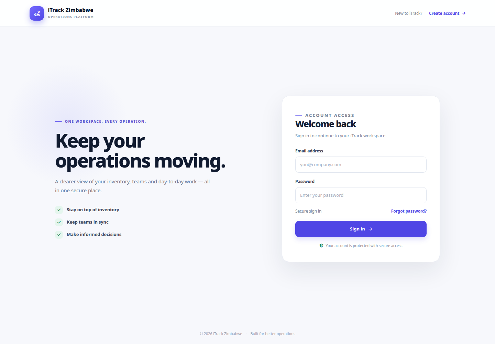
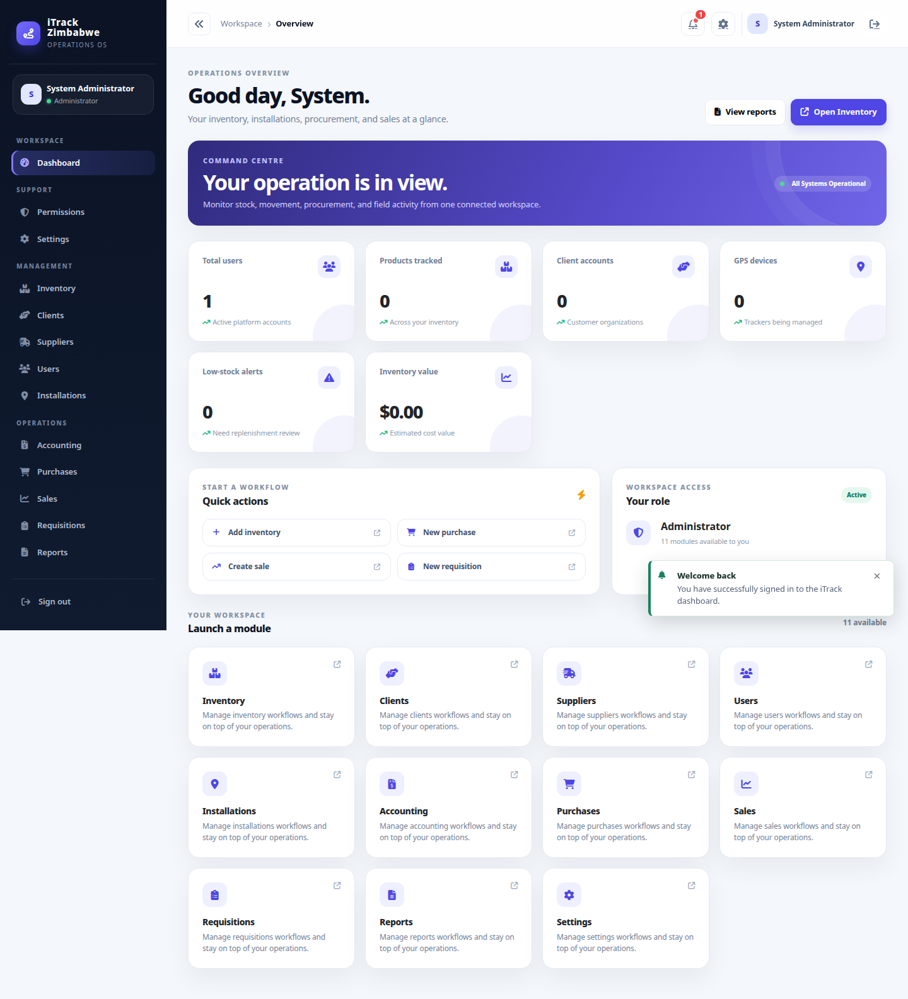
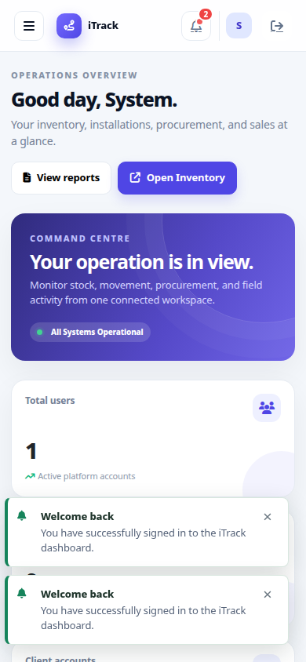
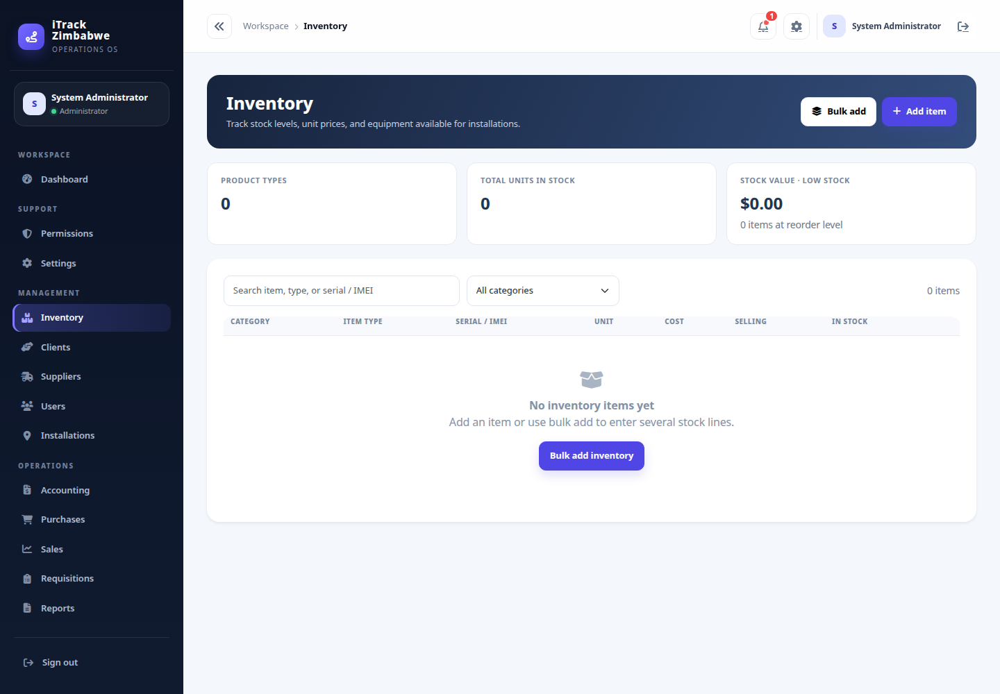
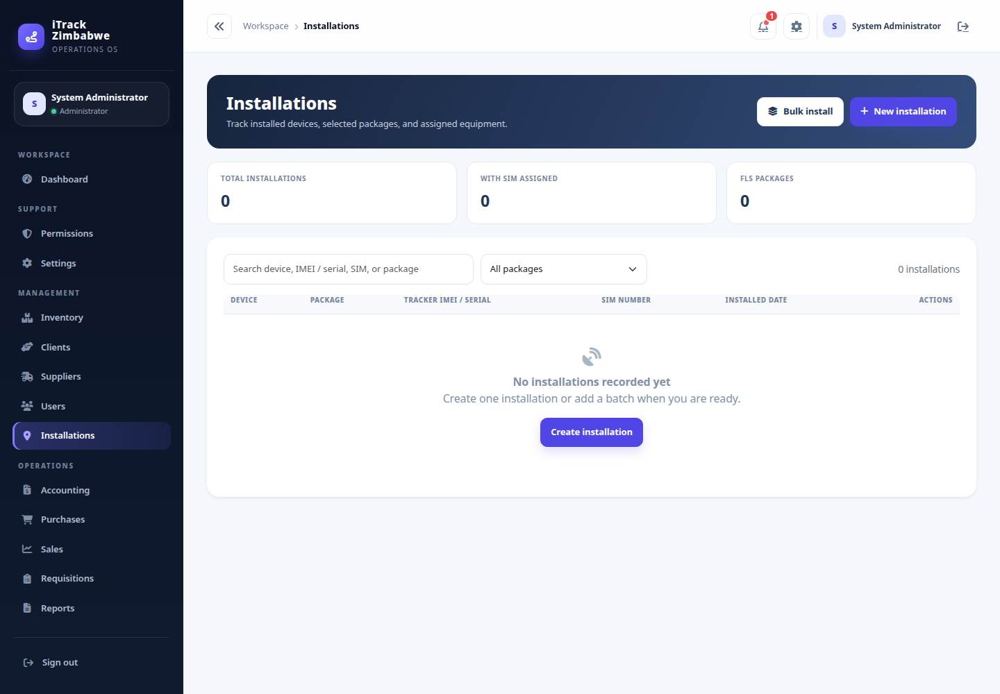
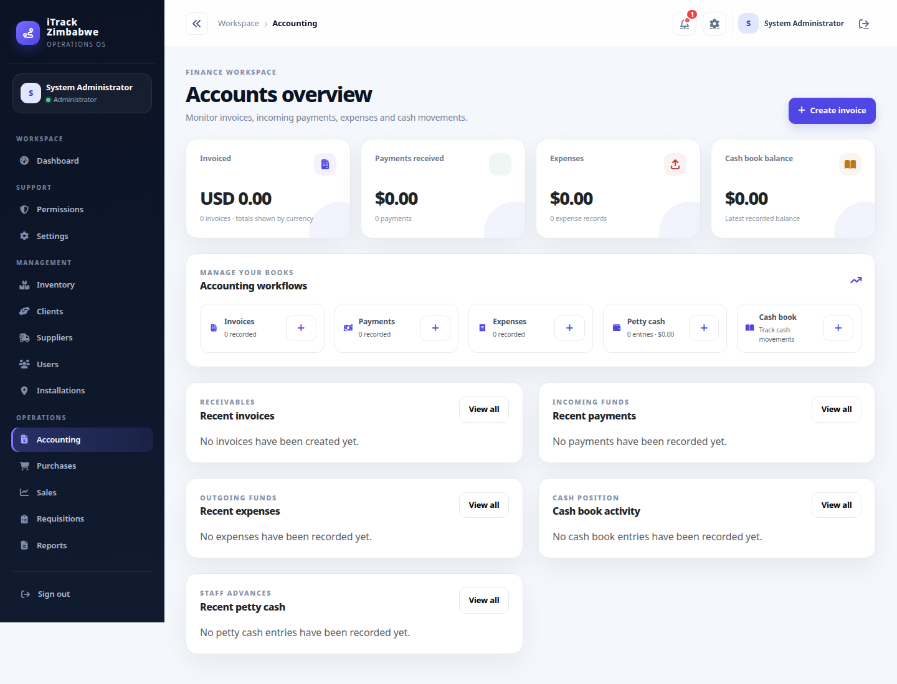
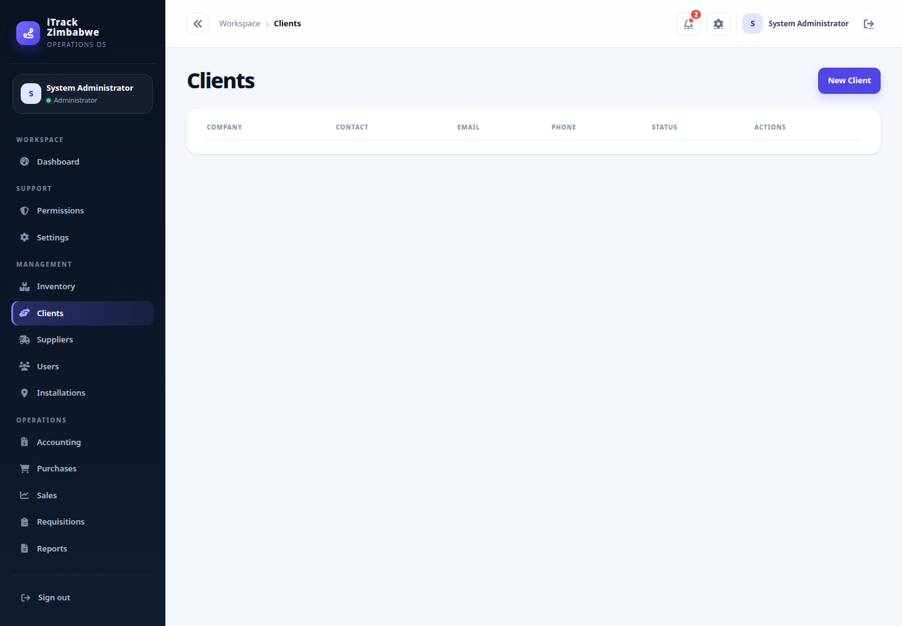

# iTrack Zimbabwe

**iTrack Zimbabwe** is a lightweight PHP 8.1+ ERP-style operations platform for managing inventory, tracker installations and removals, procurement, sales, accounting, requisitions, reporting, and users.

The application uses a small MVC structure built with plain PHP classes and PDO. It can run locally with SQLite and can be deployed with MySQL behind Apache, Nginx, or another PHP-capable web server.

## Current functionality

### Authentication and access control

- Login and logout with session-based authentication.
- Optional staff registration, controlled by `APP_ALLOW_REGISTRATION`.
- Forgot-password and expiring password-reset-token flows.
- Authenticated password changes.
- CSRF protection, server-side validation, input sanitisation, and permission checks.
- Role-aware navigation and module access.
- Configurable role/module permission matrix.

### Operations modules

- **Dashboard** – role-aware workspace with operational summaries and available-module access.
- **Inventory** – individually recorded trackers, FLS units, cameras, SIM lines, and related equipment, including cost and selling prices.
- **Bulk inventory** – create multiple stock lines manually or upload Excel (`.xlsx`) / CSV files.
- **Installations / GPS devices** – record Basic, FLS, and camera packages with a client, installer, IT support person, vehicle identifiers, and separate device/camera SIM lines. Equipment is assigned from available stock.
- **Bulk installations** – record several installations in one workflow.
- **Deinstallations** – record devices and cameras removed from vehicles, including registration and chassis numbers; returned equipment is restored to inventory.
- **Clients** – customer and client organization records.
- **Suppliers** – procurement partner records.
- **Purchases** – purchase-order capture and status updates with supplier workflows.
- **Sales** – sales capture and status visibility.
- **Requisitions** – installation and other-item requests with quantities, reason, amount, and requestor/approver digital signatures.
- **Users** – staff accounts, roles, departments, and account status management.
- **Settings** – application administration and configuration access.

### Accounting and reporting

- **Accounting summary** with access controlled for finance users.
- **Invoices** with create, edit, delete, and print views.
- **Payments**, **expenses**, **petty cash**, and **cash book** records with CRUD workflows.
- **Reports** with operational and financial report types, preset periods, custom date ranges, previews, generated records, and export support.
- **Report exports** through the PDF and XLSX report services.
- Optional OpenRouter-powered business insights using bounded report aggregates. The assistant does not execute AI-generated SQL or receive customer names.

## Requirements

- PHP 8.1 or newer.
- PDO SQLite for the local fallback, or PDO MySQL for MySQL deployments.
- PHP ZipArchive and SimpleXML extensions to import `.xlsx` inventory workbooks (CSV imports do not need these extensions).
- A web server such as Apache or Nginx for production, or PHP's built-in server for local development.
- A writable `storage/` directory for the SQLite database, logs, and runtime files.
- A writable `uploads/` directory when upload features are enabled.
- Composer is optional; the project currently has no third-party runtime dependency requirement.

## Quick start

From the repository root:

```bash
git clone https://github.com/PraiseTechzw/itrack-zimbabwe.git
cd itrack-zimbabwe
php -S 127.0.0.1:8000 -t public
```

Open [http://127.0.0.1:8000/login.php](http://127.0.0.1:8000/login.php).

On Windows with XAMPP, use the PHP executable supplied by XAMPP:

```powershell
C:\xampp\php\php.exe -S 127.0.0.1:8000 -t public
```

Make sure the runtime directories exist and are writable by the PHP process:

```bash
mkdir -p storage uploads
chmod -R u+rwX storage uploads
```

The application creates `storage/itrack.sqlite` automatically when SQLite is selected or when PDO MySQL is unavailable.

## Configuration

The application reads an optional `.env` file from the repository root. Environment variables can also be supplied by the server process.

```dotenv
APP_NAME="iTrack Zimbabwe"
APP_ENV=development
APP_DEBUG=false
APP_BASE_URL=/itrack-zimbabwe
APP_PUBLIC_URL=
APP_ALLOW_REGISTRATION=true
APP_SESSION_SECURE=false
SESSION_NAME=itrack_session
CSRF_TOKEN_NAME=csrf_token

# Use mysql explicitly for production, or auto for the default behaviour.
DB_DRIVER=auto
DB_HOST=127.0.0.1
DB_PORT=3306
DB_NAME=itrack_zimbabwe
DB_USER=root
DB_PASS=
DB_SQLITE_PATH=/absolute/path/to/storage/itrack.sqlite

UPLOAD_DIR=/absolute/path/to/uploads
MAIL_FROM=no-reply@example.com

# Optional Reports assistant
OPENROUTER_API_KEY=
OPENROUTER_MODEL=openrouter/free
```

Important configuration notes:

- Set `APP_BASE_URL` to the path where the application is mounted. Use `/` when it is served at the domain root.
- Set `APP_PUBLIC_URL` when generated links must use a complete public URL.
- Set `APP_SESSION_SECURE=true` when the application is served over HTTPS.
- Disable public registration in production unless it is intentionally required.
- Keep database credentials and API keys out of source control.
- `DB_DRIVER=mysql` selects MySQL explicitly. The default `auto` mode uses the available PDO driver and falls back to SQLite when MySQL is unavailable.

## Default local login

The seeded local account is:

- Email: `admin@example.com`
- Password: `password`

Change this password immediately outside a local development environment.

## Current application screenshots

The following screenshots were captured from the running application after the current build was started and authenticated with the local seeded account. They are documentation captures only and contain no production data.

| Screen | Preview |
|---|---|
| Login |  |
| Dashboard |  |
| Dashboard mobile |  |
| Inventory |  |
| Installations / GPS devices |  |
| Accounting |  |
| Reports |  |
| Clients |  |

## MySQL setup

For a new MySQL database:

1. Create a database named `itrack_zimbabwe`.
2. Configure the `DB_*` variables in `.env`.
3. Import [`database/schema.sql`](database/schema.sql).
4. Import [`database/seed.sql`](database/seed.sql).
5. Apply any required scripts in [`database/migrations/`](database/migrations/) to an existing database before deploying code that depends on those changes.

Important migrations cover inventory device details, IMEIs, SIM numbers, password-reset tokens, stock-backed installations and invoices, and the mobile-line/SIM-card model update.

## Application routes

Authenticated modules are routed through `public/index.php` using `controller` and `action` query parameters. Examples:

```text
/index.php?controller=inventory
/index.php?controller=gps
/index.php?controller=accounting&action=invoices
/index.php?controller=purchases
/index.php?controller=sales
/index.php?controller=requisition
/index.php?controller=reports
/index.php?controller=permissions
/index.php?controller=settings
```

Public entry points are available under [`public/`](public/), including the login, logout, dashboard, and API entry points. The repository-level [`api/`](api/) copies remain available for Apache deployments that expose them directly.

## JSON API

The read-oriented API endpoints return JSON with an `ok` flag and module-specific data. The authentication endpoint also supports login and session checks.

| Endpoint | Purpose |
|---|---|
| `/api/auth.php` | Authentication and session status |
| `/api/inventory.php` | Inventory products and stock records |
| `/api/purchases.php` | Purchase orders |
| `/api/sales.php` | Sales records |
| `/api/requisitions.php` | Requisitions |
| `/api/reports.php` | Reports |
| `/api/accounting.php` | Accounting data |
| `/api/gps.php` | Tracker installation / GPS device records |

When using the built-in server, use the corresponding paths under `public/api/`, for example `http://127.0.0.1:8000/api/inventory.php`.

## Project structure

```text
app/
  config/        Environment, application, database, and route configuration
  controllers/   Request handlers for each module
  core/          Router, controller, model, database, session, and security classes
  helpers/       Authentication, permissions, validation, formatting, uploads, and responses
  middleware/    Authentication, administrator, and permission middleware
  models/        Database models and domain operations
  services/      Report formatting, PDF/XLSX generation, and optional AI insights
  views/         Server-rendered PHP views
public/          Web document root and public entry points
api/             API entry points for direct Apache deployments
database/        Schema, seed data, migrations, and backup guidance
docs/            Installation, development, architecture, deployment, and security guides
tests/           Lightweight verification scripts
storage/         Writable runtime data, including the SQLite database
uploads/         Writable uploaded documents and media
```

See the [architecture guide](docs/ARCHITECTURE.md) for request flow and core components, and the [development guide](docs/DEVELOPMENT.md) for the recommended MVC workflow.

## Development and verification

Useful checks from the repository root:

```bash
# Syntax-check all PHP source files
find app api public includes tests -type f -name '*.php' -print0 | xargs -0 -n1 php -l

```

The project currently relies primarily on PHP syntax checks, module smoke tests, and manual browser verification.

Before opening a pull request, verify login, role-based navigation, CRUD actions, bulk inventory, installations, accounting workflows, report previews/exports, API responses, and password recovery in the target environment.

## Deployment and security

For production deployments:

- Point the web-server document root at [`public/`](public/), not the repository root.
- Enable PHP and `pdo_mysql` when using MySQL.
- Use HTTPS and set `APP_SESSION_SECURE=true`.
- Keep `storage/` and `uploads/` writable but prevent source files and secrets from being served publicly.
- Rotate the default administrator password and use strong individual passwords.
- Restrict database, log, upload, and backup permissions.
- Keep PHP, the web server, and database server updated.

Read the [installation guide](docs/INSTALLATION.md), [deployment guide](docs/DEPLOYMENT.md), and [security guide](docs/SECURITY.md) for additional guidance. Report security issues privately to the repository maintainer rather than opening a public issue.

## License

See [`LICENSE`](LICENSE) for the project license.
