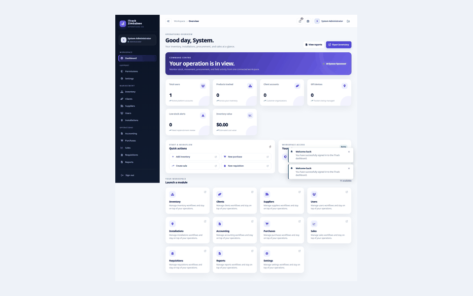

# Current application screenshots

These screenshots were captured from the running iTrack Zimbabwe application after the current build was started. Desktop captures use a 1440 × 1000 viewport and the mobile dashboard capture uses a 390 × 844 viewport. The gallery is documentation-only and contains no production data.

## Product tour

## Public and authentication screens

| Screen | Capture |
|---|---|
| Login | [login.png](login.png) |
| Registration | [register.png](register.png) |
| Forgot password | [forgot-password.png](forgot-password.png) |
| Reset password | [reset-password.png](reset-password.png) |
| Change password | [change-password.png](change-password.png) |

## Workspace and administration

| Screen | Capture |
|---|---|
| Dashboard | [dashboard.png](dashboard.png) |
| Mobile dashboard | [dashboard-mobile.png](dashboard-mobile.png) |
| Users | [users.png](users.png) |
| User form | [users-form.png](users-form.png) |
| Permissions | [permissions.png](permissions.png) |
| Settings | [settings.png](settings.png) |
| Notifications | [notifications.png](notifications.png) |

## Inventory and installations

| Screen | Capture |
|---|---|
| Inventory | [inventory.png](inventory.png) |
| Inventory form | [inventory-form.png](inventory-form.png) |
| Bulk inventory | [inventory-bulk.png](inventory-bulk.png) |
| Installations / GPS | [gps.png](gps.png) |
| Installation form | [gps-form.png](gps-form.png) |
| Bulk installations | [gps-bulk.png](gps-bulk.png) |

## Clients and suppliers

| Screen | Capture |
|---|---|
| Clients | [clients.png](clients.png) |
| Client form | [clients-form.png](clients-form.png) |
| Suppliers | [suppliers.png](suppliers.png) |
| Supplier form | [suppliers-form.png](suppliers-form.png) |

## Procurement and commercial operations

| Screen | Capture |
|---|---|
| Purchases | [purchases.png](purchases.png) |
| Sales | [sales.png](sales.png) |
| Requisitions | [requisitions.png](requisitions.png) |

## Accounting and reporting

| Screen | Capture |
|---|---|
| Accounting summary | [accounting.png](accounting.png) |
| Invoices | [accounting-invoices.png](accounting-invoices.png) |
| Invoice form | [accounting-invoice-form.png](accounting-invoice-form.png) |
| Payments | [accounting-payments.png](accounting-payments.png) |
| Expenses | [accounting-expenses.png](accounting-expenses.png) |
| Petty cash | [accounting-petty-cash.png](accounting-petty-cash.png) |
| Cash book | [accounting-cash-book.png](accounting-cash-book.png) |
| Reports | [reports.png](reports.png) |

The root [README](../../README.md) contains a compact gallery and the complete setup overview.
